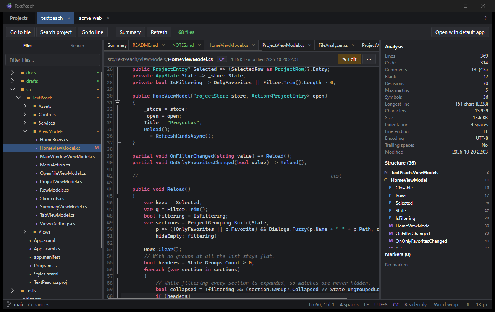
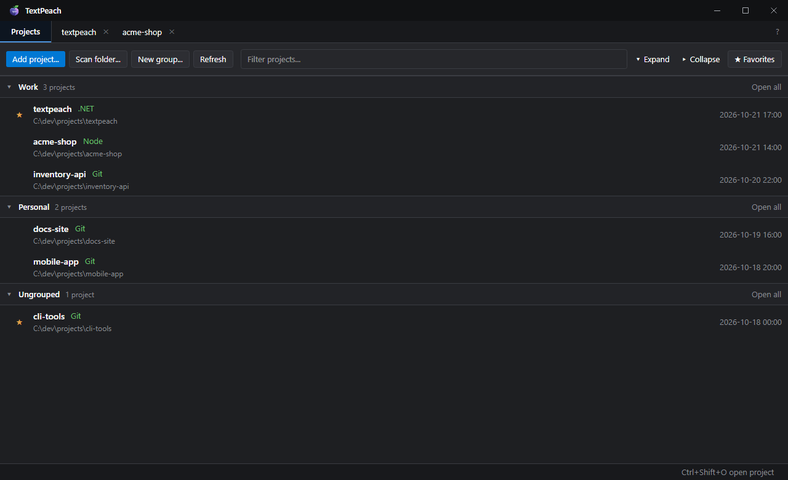
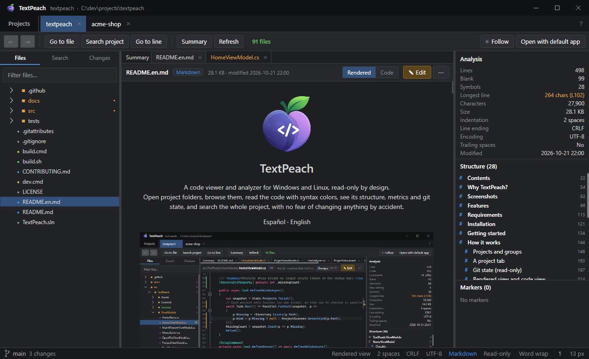
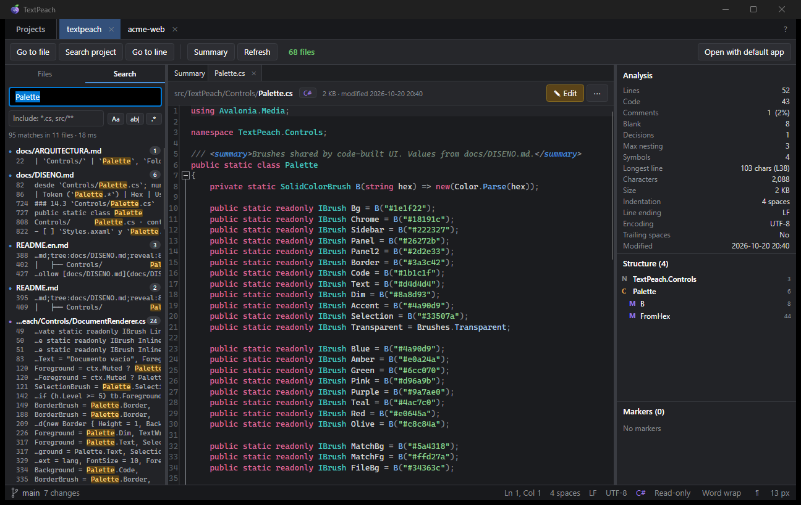
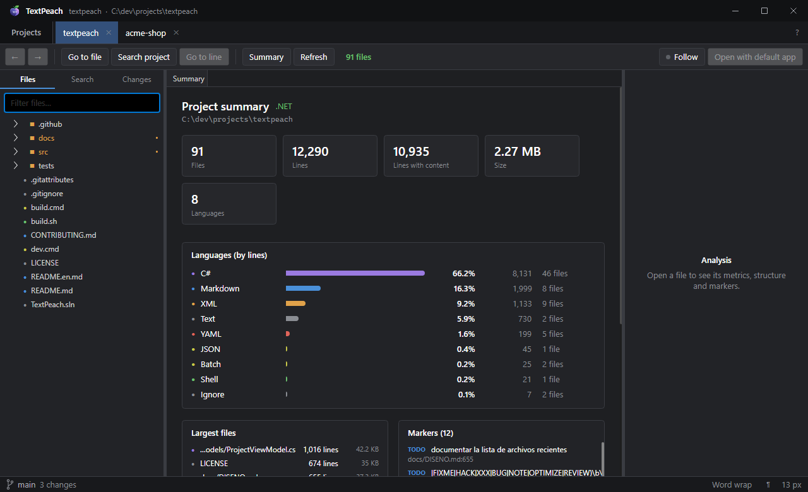
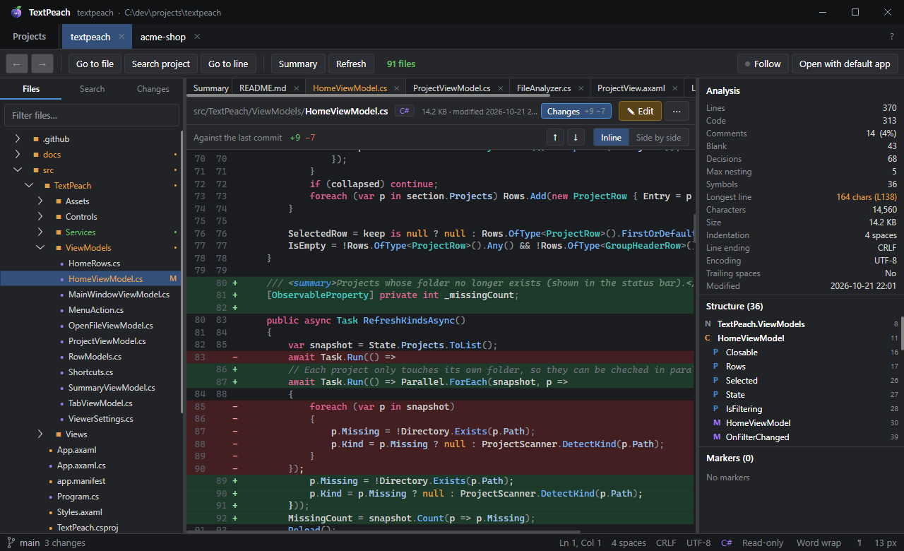
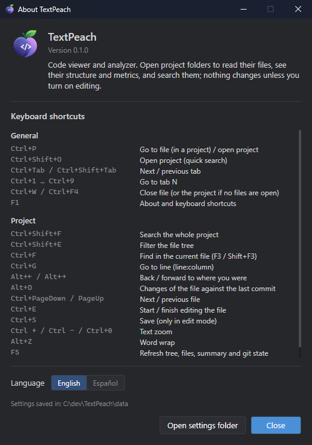

<p align="center">
  
</p>

<h1 align="center">TextPeach</h1>

<p align="center">
  A code viewer and analyzer for Windows and Linux, <b>read-only</b> by design.<br/>
  Open project folders, browse them, read the code with syntax colors, see its structure, metrics and git state, and search the whole project, with no fear of changing anything by accident.
</p>

<p align="center">
  <a href="README.md">Español</a> · <b>English</b>
</p>

<p align="center">
  
</p>

---

## Contents

- [Why TextPeach?](#why-textpeach)
- [Screenshots](#screenshots)
- [Features](#features)
- [Requirements](#requirements)
- [Installation](#installation)
- [Getting started](#getting-started)
- [How it works](#how-it-works)
  - [Projects and groups](#projects-and-groups)
  - [A project tab](#a-project-tab)
  - [Git state (read-only)](#git-state-read-only)
  - [Rendered view and code view](#rendered-view-and-code-view)
  - [Analysis panel](#analysis-panel)
  - [Project summary](#project-summary)
  - [Search](#search)
  - [Editing (optional)](#editing-optional)
  - [Changes on disk](#changes-on-disk)
  - [Language](#language)
- [Keyboard shortcuts](#keyboard-shortcuts)
- [Command line and integration](#command-line-and-integration)
- [Supported languages](#supported-languages)
- [Data, privacy and portable mode](#data-privacy-and-portable-mode)
- [Known limits](#known-limits)
- [Building from source](#building-from-source)
- [Repository layout](#repository-layout)
- [Contributing](#contributing)
- [Versions and releases](#versions-and-releases)
- [License and credits](#license-and-credits)

---

## Why TextPeach?

TextPeach was made for **working with AI agents**. You ask your favorite AI app for the changes and keep
TextPeach open next to it to **watch in real time** which files it touches, what changed according to git and
how the code turns out, with no editor tempting you to step in and no risk of overwriting what the agent is
writing.

It also fits any moment when you want to **review** rather than **write**: getting to know a new repository,
doing a review, reading documentation or finding where something is used. Code editors are built for
writing: they leave the cursor ready to type, warn about unsaved changes and fill the screen with tools you
don't need.

TextPeach flips the priority:

- **Everything opens read-only.** Typing changes nothing. To edit a file you press an explicit button
  (**✎ Edit**) and save by hand.
- **It keeps itself up to date.** When a file changes on disk, the view reloads and keeps the cursor and
  scroll position; the tree and the git state update too.
- **It shows git, but never touches it.** The branch and the modified, new or conflicted files look like
  they do in most editors. Git actions are left to [GitPeach](https://github.com/rileydev23/gitpeach).
- **It reads like a reader.** Markdown and text open *rendered* (headings, tables, lists, code) and the
  source is one click away.
- **It tells you what each file is like:** lines of code and comments, approximate complexity, nesting,
  structure (classes, methods, headings…), TODO/FIXME, encoding, indentation and line endings.
- **It handles many projects at once,** in tabs and organized in groups.

It is a single portable `.exe` (or an installer, if you prefer), no accounts, and it only goes online to tell you
about a new version. In English and Spanish.

## Screenshots

| | |
|---|---|
|  |  |
| **Projects:** groups, favorites and the type of each project. | **Rendered view:** Markdown with headings, lists and images; structure on the right. |
|  |  |
| **Search:** live, with match case, whole word, regex and *globs*. | **Summary:** totals, languages, largest files and markers. |

<p align="center">
  <br/>
  <sub><b>Changes (Alt+D):</b> the file against the last commit, in one column or side by side.</sub>
</p>

<p align="center">
  <br/>
  <sub><b>About (F1):</b> version, keyboard shortcuts, language and settings folder.</sub>
</p>

## Features

| Area | What it includes |
|---|---|
| **Projects** | Persistent list of folders, favorites ★, collapsible groups, fuzzy filter, folder scanning (what it finds is saved as a group), drag and drop, several open tabs restored on restart. |
| **Explorer** | Lazy file tree (skips `node_modules`, `bin`, `obj`, `.git`, `dist`…), quick filter by name, "Go to file" (Ctrl+P) with smart ranking. |
| **Git state** | Current branch (with commits to push or pull) in the status bar; modified, new, added, renamed, conflicted and ignored files with their color and letter, also on folders and tabs. Read-only: clicking the branch opens the repository in GitPeach. |
| **Code viewer** | TextMate highlighting (the same grammars many modern editors use), line numbers, code folding, current line, zoom, word wrap, show spaces/tabs/line endings, find in file (Ctrl+F), go to line (Ctrl+G). |
| **Rendered view** | Markdown (headings, lists, tasks, tables, quotes, code blocks, local images, links) and formatted plain text. **Rendered \| Code** switch. |
| **Per-file analysis** | Metrics with amber warnings, navigable structure (outline), TODO/FIXME/HACK/BUG/NOTE markers. |
| **Project summary** | Totals of files, lines and size, split by language, largest files and every marker in the project. |
| **Global search** | Live, with match case, whole word, regular expression and *glob* filter (`*.cs, src/**`); results grouped by file with the match highlighted. |
| **Images** | Preview of PNG, JPG, GIF, BMP, ICO and WebP with dimensions. |
| **Optional editing** | Per file, explicit, with a visible warning; saves with the original encoding and BOM. |
| **Languages** | English and Spanish; follows the Windows language or the one you pick in **About**. |
| **Integration** | Paths on the command line, single instance (other apps can ask it to open folders and files), "Open with the default app", link to GitPeach. |

## Requirements

- **To use it:** 64-bit Windows 10 or 11, or Linux x64 with a desktop (X11 or XWayland). No .NET installation
  needed (the executable is self-contained).
- **To see the git state:** [Git for Windows](https://git-scm.com/download/win) on the `PATH` (or in its
  usual install folder); on Linux, your distribution's `git`. Without git, TextPeach works the same, just without that information.
- **To build it:** the [.NET 10 SDK](https://dotnet.microsoft.com/download).

## Installation

Download whichever you prefer from the repository's *Releases* (or build it, see
[Building from source](#building-from-source)):

- **Windows, installer:** `TextPeach-Setup.exe`. It installs for your user only (no administrator) into
  `%LOCALAPPDATA%\Programs\TextPeach`, shows up in Start menu search and is uninstalled from
  **Settings > Apps**.
- **Windows, portable:** `TextPeach.exe`. Put it in any folder and run it.
- **Linux:** `TextPeach-linux-x64.tar.gz`. Unpack it with `tar -xzf TextPeach-linux-x64.tar.gz` and run
  `./TextPeach`, or `./install.sh` to install it for your user (no root): it goes to `~/.local/opt/textpeach`,
  with a `textpeach` command and an entry in the app menu. To remove it, `~/.local/opt/textpeach/uninstall.sh`.

*(Optional)* **Portable mode:** create an empty `portable.txt` file next to the `.exe` and the data will be stored
in `.\data\` instead of your profile. Uninstalling never deletes your data.

### Updates

Once a day, when it opens, TextPeach asks GitHub whether there is a new version. If there is, a **↑ 1.2.0**
button appears next to **?**; nothing else changes. Clicking it shows what is new and lets you choose
**Update and restart**, **Not now** or **Skip this version**. Updating checks the download against its SHA-256,
restarts TextPeach and reopens your tabs. If you used the installer, it updates by running the new installer
silently. In **About** (F1) you can turn the automatic check off or check right away.

Every time it starts, TextPeach writes where it is to `%APPDATA%\peachapps\TextPeach\location.json`. That way
the other apps of the family (such as GitPeach) find it even if you move it: just open it once from its new
location.

## Getting started

1. In the **Projects** tab, press **Add project...** and pick a folder. You can also **drag folders** onto
   the window.
2. Got a folder with many projects inside? Use **Scan folder...**: TextPeach finds the projects it contains
   and saves them in a group named after that folder.
3. Double-click a project to open it in a new tab.
4. Pick files in the tree on the left (or with **Ctrl+P**). Their analysis shows up on the right.
5. Use **Ctrl+Shift+F** to search the whole project and **F1** to see every shortcut.

## How it works

### Projects and groups

A *project* is just a folder. TextPeach detects its type from well-known files (`.sln`/`.csproj` → .NET,
`package.json` → Node, `Cargo.toml` → Rust, `go.mod` → Go, `pyproject.toml` → Python, `pom.xml` → Java,
etc.) and shows it in green next to the name.

- **Favorites:** listed first within their group; the **★ Favorites** button shows only those.
- **Groups:** **New group...** creates an empty one; the context menu of a project (or of several selected
  with Ctrl/Shift) offers **Move to group**, a new group or **Remove from group**. Each header collapses with
  a click, shows how many projects it has and offers **Open all**. Its menu renames the group, deletes it
  (its projects become ungrouped) or removes it together with its projects.
- **Scan folder:** goes up to four levels deep, stops at each project it finds (it does not look inside
  them) and groups them under the scanned folder's name. Projects already in another group stay there.
- **Dragging a folder:** if it is a project, it is added; if it contains several projects, it is imported
  as a group.
- **Remove from the list** never deletes anything from disk.

### A project tab

```
┌ Toolbar: Go to file · Search project · Go to line │ Summary · Refresh   N files   [Open with default app]
├──────────────┬─────────────────────────────────────────────┬──────────────────────┤
│ Files        │ Summary │ file-a ✕ │ file-b ✕                │ Analysis             │
│  / Search    │ path/file.ext  [Language]  [Rendered|Code] [✎ Edit] [⋯]          │
│              │                                              │ Structure (n)        │
│ tree with    │   highlighted code, folding and line         │ Markers (n)          │
│ git state  M │   numbers · or the rendered document         │                      │
├──────────────┴─────────────────────────────────────────────┴──────────────────────┤
│ ⑂ main ↑1  3 changes   notice       Ln 12, Col 5 · 4 spaces · LF · UTF-8 · C# · Read-only │
└────────────────────────────────────────────────────────────────────────────────────┘
```

- **Left panel:** **Files / Search** switch. In *Files*, the filter at the top replaces the tree with a flat
  list of matches (↓ to enter the list, Enter to open, Esc to clear).
- **Center:** tabs of the open files (the first one, **Summary**, is fixed). Context menu: close others or
  all. Switching tabs keeps each file's cursor and scroll position. With many tabs, the mouse wheel scrolls
  them sideways and a thin bar shows up below them, never on top of them.
- **File ⋯ menu:** copy full or relative path, reveal in tree, open with the default app, reload from disk.
- **Status bar:** git branch on the left; on the right, cursor position, indentation, line ending, encoding,
  language and mode (*Read-only* / *Editing*); word wrap, invisible characters (¶) and font size.

### Git state (read-only)

When the project is inside a git repository, TextPeach shows its state the way most editors do, **without
running any git action**: no stage, commit, checkout, pull or push, and it doesn't even refresh the index (it
uses `git --no-optional-locks status`).

| State | Color | Letter |
|---|---|---|
| Modified | amber | `M` |
| Untracked (new) | green | `U` |
| Added to the index | green | `A` |
| Renamed | teal | `R` |
| Deleted | red | `D` |
| Conflicted | pink | `!` |
| Ignored | gray | — |

- The file **name** takes the color of its state in the tree, in the filter list and on its tab; the
  **letter** shows up on the right.
- **Folders** show a dot (•) in the color of the most important change inside them, so you can see where
  things changed even when they are collapsed.
- The **branch** sits at the bottom left, with `↑n` / `↓n` when there are commits to push or pull, and the
  number of changed files. Its tooltip gives the details. With a detached *HEAD* it shows the commit.
- **Clicking the branch opens the repository in GitPeach**, the git client of the Peach family. If GitPeach
  is not on the computer, TextPeach explains it and offers to go to its repository to download it.
- The state updates by itself when something changes in the folder or inside `.git` (a commit or a branch
  switch made from another app), and with **F5**.

### Rendered view and code view

`.md`, `.markdown`, `.mdx`, `.txt` and `.text` files (up to 2 MB) open in the **rendered view**. The
**Rendered | Code** switch in the header toggles between both.

- Markdown is parsed with [Markdig](https://github.com/xoofx/markdig) and drawn with native controls (no
  embedded browser): headings, paragraphs, bold/italic/strikethrough, inline and block code, numbered and
  bulleted lists, task lists, quotes, tables, rules and local images. Raw HTML is shown as text and **never
  runs**; remote images are not downloaded.
- **Links:** to another file of the project open it in TextPeach; `#anchor` scrolls the document;
  `http(s)` and `mailto` open with the default app.
- Clicking the **structure** scrolls the rendered view to that section. A search result (which needs the
  exact position) or **Edit** switch to the code view.

### Analysis panel

Computed in the background when the file opens (and while you edit, after a 0.8 s pause).

| Metric | How it is computed | Amber warning |
|---|---|---|
| Lines | Physical lines (a final line break does not count an extra line). | — |
| Code / Comments | Lines that start with a line comment or sit inside a block comment count as comments (approx.). | — |
| Blank | Empty or whitespace-only lines. | — |
| Decisions | Approximate count of `if`, `for`, `while`, `case`, `catch`, `&&`, `||`, `?:`… A complexity indicator. | > 150 |
| Max nesting | Deepest level of `{ }` braces (ignoring strings). | > 6 |
| Symbols | Items found in the structure. | — |
| Longest line | Characters and line number. | > 160 |
| Indentation | Tabs, *N* spaces or mixed. | Mixed |
| Line ending | CRLF, LF or mixed. | Mixed |
| Encoding | UTF-8, UTF-8 BOM, UTF-16 LE/BE or Latin-1. | — |
| Trailing spaces | Whether any line ends in spaces or tabs. | Yes |

**Structure:** classes, interfaces, structs, enums, records, functions, methods and properties (code
languages), headings (Markdown), selectors and `@` rules (CSS), top-level keys (JSON, YAML, TOML, INI),
`CREATE …` objects (SQL) and the element hierarchy with its `id`/`x:Name` (XML, XAML, HTML). Detection uses
regular expressions per language family: fast and good enough to find your way, but it is not a compiler.

**Markers:** `TODO`, `FIXME`, `HACK`, `XXX`, `BUG`, `NOTE`, `OPTIMIZE`, `REVIEW` with their text and line,
colored by severity. In Markdown and text they only count when they start the line, and never inside
`inline code`.

### Project summary

The **Summary** tab analyzes every file of the project in parallel (files over 2 MB and binaries are counted
but not read): files, lines, lines with content, total size, number of languages, bars per language (share of
lines), the twelve largest files and up to 300 markers. Everything is clickable.

### Search

- **Go to file (Ctrl+P):** ranks by exact name, name prefix, name contains, path contains and, last, fuzzy
  match; on a tie, the shorter path wins.
- **Search project (Ctrl+Shift+F):** live while you type. Options `Aa` (match case), `ab|` (whole word) and
  `.*` (regular expression), and an *Include* field with comma-separated globs. Selected text is used as the
  query. Up to 3,000 matches (200 per file).
- **Find in file (Ctrl+F):** the viewer's search panel, with F3 / Shift+F3.

### Editing (optional)

1. Press **✎ Edit** (or Ctrl+E). An amber strip appears: *changes are written to disk only when you press
   Save*.
2. **Save** (Ctrl+S) writes the file with its original encoding (BOM included, if it had one).
3. **Finish editing** (Ctrl+E) goes back to read-only; with unsaved changes it asks
   *Save / Discard / Cancel*.

The tab shows `✎` while you edit and `●` when there are unsaved changes. Closing the tab, the project or the
app with pending changes always asks first.

### Changes on disk

Each project watches its folder. If an open file changes outside TextPeach (for example, because your AI
agent edited it), it reloads by itself and keeps the cursor and scroll position; if you were editing it, a
notice with **Reload** appears instead of overwriting your work. The tree, the summary and the git state
update when files are created, deleted or renamed.

### Language

The interface comes in **English** and **Spanish**. By default it follows the Windows language (Spanish when
Windows is in Spanish, English otherwise). To choose it yourself, open **About** (F1) and use the **Language**
switch; the change applies the next time you open TextPeach.

## Keyboard shortcuts

| Shortcut | Action |
|---|---|
| `Ctrl+P` | Go to file (in a project) / open project |
| `Ctrl+Shift+O` | Open project (quick search) |
| `Ctrl+Tab` / `Ctrl+Shift+Tab` | Next / previous tab |
| `Ctrl+1 … Ctrl+9` | Go to tab N (1 = Projects) |
| `Ctrl+W` / `Ctrl+F4` | Close the current file (or the project if no files are open) |
| `F1` | About, keyboard shortcuts and language |
| `Ctrl+Shift+F` | Search the whole project |
| `Ctrl+Shift+E` | Filter the file tree |
| `Ctrl+F`, `F3`, `Shift+F3` | Find in the current file |
| `Ctrl+G` | Go to line (`line` or `line:column`) |
| `Ctrl+PageDown` / `Ctrl+PageUp` | Next / previous file |
| `Ctrl+E` | Start / finish editing the file |
| `Ctrl+S` | Save (only in edit mode) |
| `Ctrl +`, `Ctrl −`, `Ctrl+0` | Text zoom |
| `Alt+Z` | Word wrap |
| `F5` | Refresh tree, files, summary and git state |
| `Enter` / `Del` in the project list | Open / remove from the list |

## Command line and integration

```
TextPeach.exe [folder] [file] ...
```

- A **folder** is added to the list (if it wasn't there) and opened in a tab.
- A **file** opens inside the saved project that contains it; if there is none, its folder is added as a
  project.
- **Single instance:** if TextPeach is already open, the new launch hands it the paths over a local *named
  pipe* (current user only), brings the window to the front and exits. That way other apps can ask it to open
  a repository or a file without duplicating windows.
- **GitPeach:** the branch button runs `GitPeach.exe <repository>`. GitPeach is looked up first where it
  said it lives (`%APPDATA%\peachapps\GitPeach\location.json`), then next to TextPeach, in a sibling
  `GitPeach` folder, in `%LOCALAPPDATA%\Programs\GitPeach`, in `%ProgramFiles%\GitPeach` and on the `PATH`.

## Supported languages

- **Syntax highlighting:** every grammar included in
  [TextMateSharp.Grammars](https://github.com/danipen/TextMateSharp) (C#, F#, VB, C/C++, Java, Kotlin, Go,
  Rust, Swift, Dart, JavaScript, TypeScript, JSX/TSX, Python, Ruby, PHP, Lua, Perl, R, Julia, PowerShell,
  Shell, Batch, SQL, HTML, XML/XAML, CSS/SCSS/Less, JSON, YAML, TOML, INI, Markdown, Dockerfile, Makefile,
  Diff, LaTeX and more), with its own *Peach Dark* theme.
- **Structure (outline):** C#, Java/Scala/Groovy/Dart, JavaScript/TypeScript (and Vue/Svelte), Python, Go,
  Rust, C/C++/Objective-C, PHP, Ruby, Kotlin, Swift, Shell, PowerShell, Lua, Markdown, CSS/SCSS/Less, SQL,
  JSON, YAML/TOML/INI and XML/XAML/HTML.
- **Comments and metrics:** the languages above plus others such as Haskell, Elixir, Erlang, Clojure, LaTeX
  or Protobuf.

To add a language, edit `src/TextPeach/Services/Languages.cs` (extension, color and comment syntax) and, for
structure, `FileAnalyzer.cs`.

## Data, privacy and portable mode

- TextPeach has no telemetry and no accounts. The only thing it does online is ask GitHub's public API for the
  latest release, at most once a day (can be turned off in **About**), and download it if you ask. It sends
  nothing about you. Web links open in your browser when you click them.
- It keeps its state in `%APPDATA%\peachapps\TextPeach\state.json` (or in `.\data\` next to the exe with
  `portable.txt`): list of projects and groups, open tabs and files, window size/position, language and
  viewer preferences. The exact path is shown in **About** (F1).
- `%APPDATA%\peachapps\TextPeach\location.json` only says where the executable is, so the other Peach apps
  can find it.
- For the git state it only **reads** the repository with your git installation; it never changes it.
- It never changes files unless you turn on editing and press **Save**.

## Known limits

| Limit | Value | What happens beyond it |
|---|---|---|
| Viewable text file | 16 MB | A notice is shown with the option to open it with the default app. |
| Rendered view by default | 2 MB | It opens in the code view. |
| Files listed per project | 60,000 | The summary marks it with "+". |
| Search matches | 3,000 (200 per file) | Marked as "(limited)". |
| Summary analysis | files ≤ 2 MB | Larger ones are counted but not read. |
| `git status` | 15 s | If it takes longer (huge repositories), no state is shown. |

Others: structure and metrics are heuristics (regex), not semantic analysis; brace folding does not
understand every string literal of every language; deleted files don't show up in the tree (they are not on
disk); changing the language needs a restart; only Windows x64 and Linux x64 builds are published (on
Linux the system title bar is used).

## Building from source

```bat
git clone https://github.com/rileydev23/textpeach.git TextPeach
cd TextPeach

dev.cmd                       :: build in Debug and run
dotnet test TextPeach.sln     :: run the tests
build.cmd                     :: produce dist\TextPeach.exe (single-file, self-contained, win-x64)
```

On Linux, `./build.sh` produces `dist/TextPeach` (linux-x64). Both take an optional version
(`build.cmd 0.4.0`) that is stamped into the executable.

`build.cmd` publishes with ReadyToRun and compression, without *trimming* (TextMate grammars are loaded
through reflection). The first build downloads the NuGet packages.

**Hands-free debugging:** in Debug, the `TEXTPEACH_DEBUG_ACTIONS` variable runs actions at startup, for
example `open:docs/DISENO.md;tree:docs/DISENO.md;reveal:80;search:Palette;diff;edit;about`. Handy for
screenshots.

## Repository layout

```
TextPeach/
├── build.cmd · dev.cmd · TextPeach.sln
├── docs/
│   ├── ARQUITECTURA.md      layers, life of a file, technical decisions (Spanish)
│   ├── DISENO.md            design system: colors, type, components, patterns (Spanish)
│   └── img/                 screenshots (Spanish; English ones in img/en/)
├── src/TextPeach/
│   ├── Assets/              icons and the peach-dark.json syntax theme
│   ├── Controls/            Palette, folding, document renderer
│   ├── Services/            state, scanner, file loader, analyzer, languages, groups, highlighting,
│   │                        single instance, git state, interface languages (Loc + Strings)
│   ├── ViewModels/          MVVM (CommunityToolkit.Mvvm)
│   └── Views/               Avalonia XAML and dialogs
└── tests/TextPeach.Tests/   xUnit: analyzer, decoding, ranking, folding, groups, git, languages
```

More detail in [docs/ARQUITECTURA.md](docs/ARQUITECTURA.md). The visual rules live in
[docs/DISENO.md](docs/DISENO.md).

## Contributing

Contributions are welcome! The full guide is in [CONTRIBUTING.md](CONTRIBUTING.md).

1. Open an *issue* describing the problem or the idea (with screenshots if it is visual).
2. *Fork* the repository, create a `feature/…`, `fix/…`, `docs/…`, `refactor/…` or `chore/…` branch and send
   a small, focused *pull request* against `main`.
3. Before sending it: `dotnet build` with no errors and `dotnet test` green. If you add pure logic
   (analyzer, parsers, groups…), add tests.

Conventions:

- **Every visible text goes in `Services/Strings.cs`** in English and Spanish (neutral Spanish, informal
  "tú", sentence case). XAML uses `{l:L key}` and C# uses `Loc.T("key")`. A test checks that every key in use
  exists in both languages. **Code, names and comments in English.**
- Follow [docs/DISENO.md](docs/DISENO.md): palette colors only, one primary button per area, read-only
  information never goes in an editable field, the interface doesn't mention third-party apps.
- Anything that touches the disk runs off the UI thread.
- Keep TextPeach read-only by default: any action that writes to disk must be explicit, and git is only
  read.

## Versions and releases

TextPeach is at **0.x**: it is usable every day, but it can still change quite a bit. **1.0.0** will come once
the app is stable and has its final icon.

Versions follow [SemVer](https://semver.org) (`MAJOR.MINOR.PATCH`) and the repository uses *GitHub Flow*: a
single main branch, `main`, with no intermediate branches (`develop`, `release/…`).

```
feature/thing ──PR──┐
fix/other ─────PR───┼──▶ main ──(when the maintainer decides)──▶ release v0.4.0 (Windows + Linux)
docs/stuff ────PR───┘
```

1. **Every change lives in its own branch** (`feature/…`, `fix/…`, `docs/…`, `refactor/…`, `chore/…`) and
   reaches `main` through a reviewed *pull request* with green CI. Nobody pushes straight to `main`.
2. **Every merge updates a draft of the next release** with the notes grouped by kind. The version is worked
   out from the branches: any `feature/` raises the minor version (0.3.2 → 0.4.0), otherwise the patch
   (0.3.2 → 0.3.3).
3. **A merge is not a release.** Several pull requests can pile up in the draft, and it is published when
   there is something worth shipping. Publishing it creates the `vX.Y.Z` tag, and a workflow
   runs the tests, builds `TextPeach.exe` and `TextPeach-linux-x64.tar.gz` with that version, checks that both
   start, and attaches them to the release.
4. While on 0.x, breaking changes also raise only the minor version. For **1.0.0**, the maintainer changes the
   draft's version by hand right before publishing it.

`main` must always build and pass the tests: every release is cut from it.

## License and credits

Copyright © 2026 [rileydev23](https://github.com/rileydev23). TextPeach is free software under the
**[GNU General Public License v3.0](LICENSE)** or later (GPL-3.0-or-later), the same license as the whole Peach
family. In short:

- **Use it for free, for anything**, companies and commercial use included.
- **You can study it, change it and share your version**, as long as it is GPLv3 too, with its source code
  available and the copyright notices kept. Nobody can take it and ship it as closed software.
- **Need a closed version** or to embed it in a proprietary product? Contact
  [rileydev23](https://github.com/rileydev23) for a commercial license.

**Name and logo:** the GPL covers the code, not the brand. "TextPeach" and its logo identify the official
version; if you publish a fork, give it another name and logo.

**About the icon:** the current icon was made with AI. If you would like to propose a better one, made by a
person, I am happy to change it! Open an *issue* with your proposal.

The binding text is the one in [LICENSE](LICENSE).

Built with:

- [Avalonia UI](https://avaloniaui.net/) (MIT)
- [AvaloniaEdit](https://github.com/AvaloniaUI/AvaloniaEdit) and AvaloniaEdit.TextMate (MIT)
- [TextMateSharp](https://github.com/danipen/TextMateSharp) and its grammars (MIT; grammars under their own licenses, mostly MIT)
- [Markdig](https://github.com/xoofx/markdig) (BSD-2-Clause)
- [CommunityToolkit.Mvvm](https://github.com/CommunityToolkit/dotnet) (MIT)

---

<p align="center"><i>Let the AI write the code; you watch, review and supervise without fear.</i></p>
