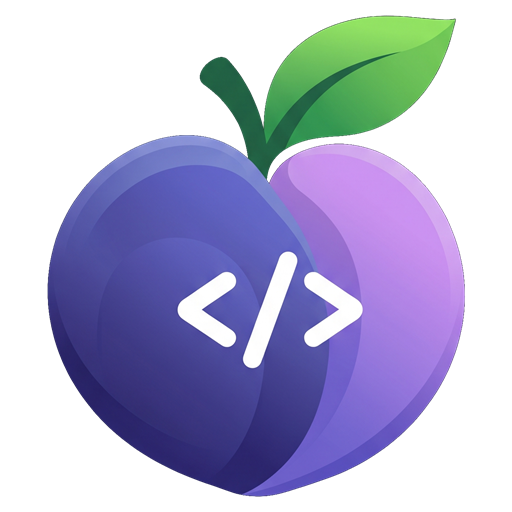
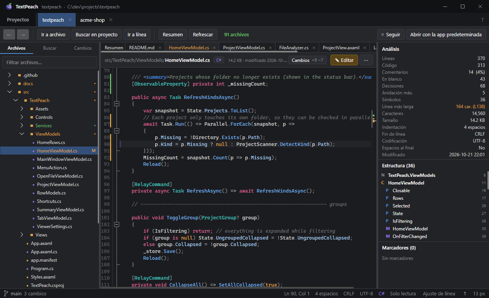
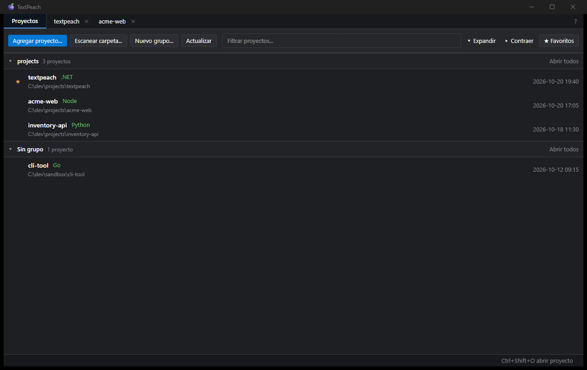
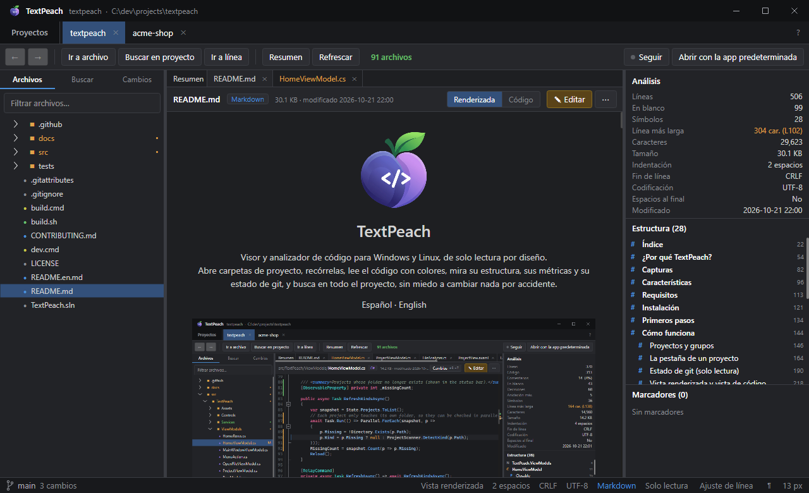
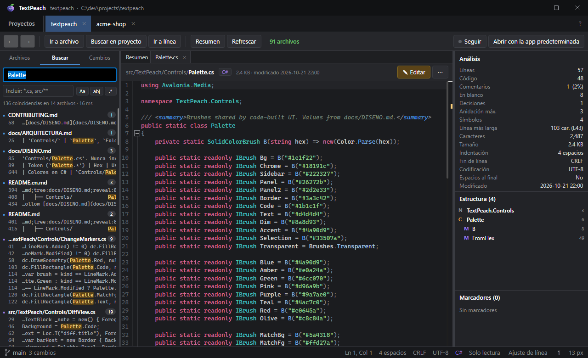
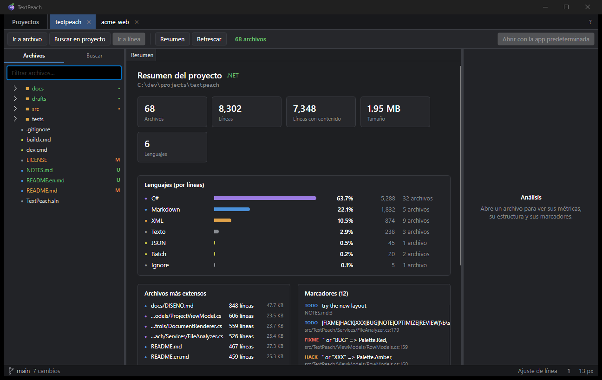
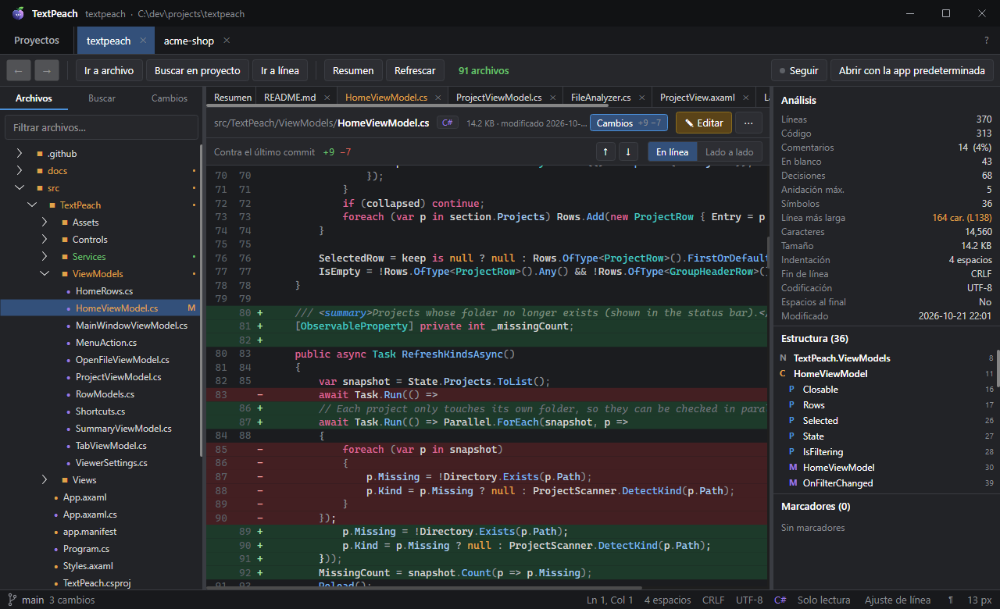
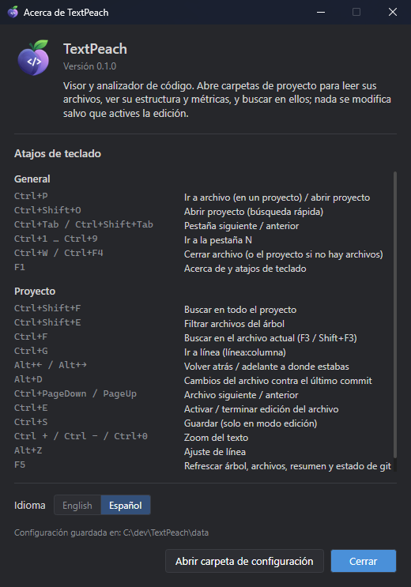

<p align="center">
  
</p>

<h1 align="center">TextPeach</h1>

<p align="center">
  Visor y analizador de código para Windows y Linux, <b>de solo lectura</b> por diseño.<br/>
  Abre carpetas de proyecto, recórrelas, lee el código con colores, mira su estructura, sus métricas y su estado de git, y busca en todo el proyecto, sin miedo a cambiar nada por accidente.
</p>

<p align="center">
  <b>Español</b> · <a href="README.en.md">English</a>
</p>

<p align="center">
  
</p>

---

## Índice

- [¿Por qué TextPeach?](#por-qué-textpeach)
- [Capturas](#capturas)
- [Características](#características)
- [Requisitos](#requisitos)
- [Instalación](#instalación)
- [Primeros pasos](#primeros-pasos)
- [Cómo funciona](#cómo-funciona)
  - [Proyectos y grupos](#proyectos-y-grupos)
  - [La pestaña de un proyecto](#la-pestaña-de-un-proyecto)
  - [Estado de git (solo lectura)](#estado-de-git-solo-lectura)
  - [Vista renderizada y vista de código](#vista-renderizada-y-vista-de-código)
  - [Panel de análisis](#panel-de-análisis)
  - [Resumen del proyecto](#resumen-del-proyecto)
  - [Búsqueda](#búsqueda)
  - [Edición (opcional)](#edición-opcional)
  - [Cambios en el disco](#cambios-en-el-disco)
  - [Idioma](#idioma)
- [Atajos de teclado](#atajos-de-teclado)
- [Línea de comandos e integración](#línea-de-comandos-e-integración)
- [Lenguajes soportados](#lenguajes-soportados)
- [Datos, privacidad y modo portable](#datos-privacidad-y-modo-portable)
- [Límites conocidos](#límites-conocidos)
- [Compilar desde el código](#compilar-desde-el-código)
- [Estructura del repositorio](#estructura-del-repositorio)
- [Contribuir](#contribuir)
- [Versiones y releases](#versiones-y-releases)
- [Licencia y créditos](#licencia-y-créditos)

---

## ¿Por qué TextPeach?

TextPeach nació para **trabajar con agentes de IA**. Le pides los cambios a tu app de IA preferida y
dejas TextPeach abierto al lado para **ver en tiempo real** qué archivos toca, qué cambió según git y cómo
queda el código, sin un editor que te tiente a meter la mano ni riesgo de pisar lo que el agente está
escribiendo.

También sirve para cualquier momento en que lo que quieres es **revisar** y no **escribir**: entender un
repositorio nuevo, hacer una revisión, leer documentación o buscar dónde se usa algo. Los editores de código
están pensados para escribir: te dejan el cursor listo para teclear, avisan de cambios sin guardar y llenan la
pantalla de herramientas que no necesitas.

TextPeach invierte la prioridad:

- **Todo se abre en solo lectura.** Teclear no cambia nada. Para editar un archivo hay que pulsar un botón
  explícito (**✎ Editar**) y guardar a mano.
- **Se actualiza solo.** Cuando un archivo cambia en el disco, la vista se recarga conservando el cursor y el
  scroll; el árbol y el estado de git también se actualizan.
- **Muestra git, pero no lo toca.** La rama, los archivos modificados, nuevos o en conflicto se ven como en
  la mayoría de los editores. Las acciones de git quedan para [GitPeach](https://github.com/rileydev23/gitpeach).
- **Lee como un lector.** Markdown y texto se abren *renderizados* (títulos, tablas, listas, código) y el
  fuente queda a un clic.
- **Te cuenta cómo es cada archivo:** líneas de código y comentarios, complejidad aproximada, anidación,
  estructura (clases, métodos, títulos…), TODO/FIXME, codificación, indentación y fin de línea.
- **Trabaja con muchos proyectos a la vez,** en pestañas y organizados en grupos.

Es un único `.exe` portable (o con instalador, si lo prefieres), sin cuentas, y solo se conecta a internet para
avisarte de una versión nueva. En español y en inglés.

## Capturas

| | |
|---|---|
|  |  |
| **Proyectos:** grupos, favoritos y tipo de cada proyecto. | **Vista renderizada:** Markdown con títulos, listas e imágenes; estructura a la derecha. |
|  |  |
| **Búsqueda:** en vivo, con mayúsculas, palabra completa, regex y *globs*. | **Resumen:** totales, lenguajes, archivos más extensos y marcadores. |

<p align="center">
  <br/>
  <sub><b>Cambios (Alt+D):</b> el archivo contra el último commit, en una columna o lado a lado.</sub>
</p>

<p align="center">
  <br/>
  <sub><b>Acerca de (F1):</b> versión, atajos de teclado, idioma y carpeta de configuración.</sub>
</p>

## Características

| Área | Qué incluye |
|---|---|
| **Proyectos** | Lista persistente de carpetas, favoritos ★, grupos plegables, filtro difuso, escaneo de carpetas (lo encontrado se guarda como un grupo), arrastrar y soltar, varias pestañas abiertas que se restauran al reiniciar. |
| **Explorador** | Árbol de archivos perezoso (ignora `node_modules`, `bin`, `obj`, `.git`, `dist`…), filtro rápido por nombre, "Ir a archivo" (Ctrl+P) con ranking inteligente. Clic derecho con lo de siempre: nuevo archivo o carpeta, cortar, copiar, pegar (también desde y hacia el Explorador), duplicar, cambiar nombre (F2), eliminar a la papelera (Supr), copiar ruta, mostrar en el Explorador y abrir con la aplicación predeterminada. |
| **Consola** | Terminales reales (PowerShell en Windows, tu shell en Linux) en la carpeta del proyecto con **Ctrl+J**: debajo del código, como una página que ocupa el lugar del código, o en una ventana aparte. Hasta 4 a la vez, en filas, columnas o cuadrícula (una en cada esquina). |
| **Estado de git** | Rama actual (con commits por enviar o traer) en la barra de estado; archivos modificados, nuevos, agregados, renombrados, en conflicto e ignorados con su color y su letra, también en las carpetas y en las pestañas. Solo lectura: un clic en la rama abre el repositorio en GitPeach. |
| **Visor de código** | Resaltado TextMate (las mismas gramáticas que muchos editores modernos), números de línea, plegado de bloques, línea actual, zoom, ajuste de línea, mostrar espacios/tabs/fines de línea, buscar en el archivo (Ctrl+F), ir a línea (Ctrl+G). |
| **Vista renderizada** | Markdown (títulos, listas, tareas, tablas, citas, bloques de código, imágenes locales, enlaces) y texto plano formateado. Conmutador **Renderizada \| Código**. |
| **Análisis por archivo** | Métricas con avisos en ámbar, estructura (outline) navegable, marcadores TODO/FIXME/HACK/BUG/NOTE. |
| **Resumen del proyecto** | Totales de archivos, líneas y tamaño, reparto por lenguaje, archivos más extensos y todos los marcadores del proyecto. |
| **Búsqueda global** | En vivo, con mayúsculas, palabra completa, expresión regular y filtro por *glob* (`*.cs, src/**`); resultados agrupados por archivo con la coincidencia resaltada. |
| **Imágenes** | Vista previa de PNG, JPG, GIF, BMP, ICO y WebP con dimensiones. |
| **Edición opcional** | Por archivo, explícita, con aviso visible; guarda con la misma codificación y BOM originales. |
| **Idiomas** | Español e inglés; sigue el idioma de Windows o el que elijas en **Acerca de**. |
| **Integración** | Rutas por línea de comandos, instancia única (otras apps pueden pedirle abrir carpetas y archivos), "Abrir con la aplicación predeterminada" (en el menú del árbol y en ⋯), enlace con GitPeach. |

## Requisitos

- **Para usarlo:** Windows 10 u 11 de 64 bits, o Linux x64 con escritorio (X11 o XWayland). No necesita .NET
  instalado (el ejecutable es autocontenido).
- **Para ver el estado de git:** [Git para Windows](https://git-scm.com/download/win) en el `PATH` (o en su
  carpeta de instalación habitual); en Linux, el `git` de tu distribución. Sin git, TextPeach funciona igual, solo que sin esa información.
- **Para compilarlo:** [SDK de .NET 10](https://dotnet.microsoft.com/download).

## Instalación

Descarga lo que prefieras desde la sección *Releases* del repositorio (o compílalo, ver
[Compilar desde el código](#compilar-desde-el-código)):

- **Windows, con instalador:** `textpeach-windows-x64-setup.exe`. Se instala solo para tu usuario (no pide administrador)
  en `%LOCALAPPDATA%\Programs\TextPeach`, aparece al buscar en el menú Inicio y se desinstala desde
  **Configuración > Aplicaciones**. Durante la instalación puedes elegir (vienen marcadas) agregar
  **"Abrir con TextPeach"** al menú contextual de archivos y carpetas del Explorador, y registrar TextPeach para
  los archivos de texto y código, para que aparezca en **"Abrir con"** y en **Configuración > Aplicaciones
  predeterminadas**. Windows solo deja que tú elijas la aplicación predeterminada: al final del instalador
  puedes marcar *Elegir TextPeach como aplicación predeterminada* y se abre esa página ya en TextPeach.
- **Windows, portable:** `textpeach-windows-x64-portable.exe`. Ponlo en la carpeta que quieras y ejecútalo.
- **Linux:** `textpeach-linux-x64.tar.gz`. Descomprímelo con `tar -xzf textpeach-linux-x64.tar.gz` y
  ejecuta `./TextPeach`, o `./install.sh` para instalarlo en tu usuario (sin root): queda en
  `~/.local/opt/textpeach`, con el comando `textpeach` y una entrada en el menú de aplicaciones. Para quitarlo,
  `~/.local/opt/textpeach/uninstall.sh`.

*(Opcional)* **Modo portable:** crea un archivo vacío `portable.txt` junto al `.exe` y los datos se guardarán en
`.\data\` en lugar de en tu perfil. Desinstalar nunca borra tus datos.

### Actualizaciones

Una vez al día, al abrirse, TextPeach mira en GitHub si hay una versión nueva. Si la hay, aparece un botón
**↑ 1.2.0** junto al **?**; nada más cambia. Al pulsarlo ves las novedades y eliges **Actualizar y reiniciar**,
**Ahora no** u **Omitir esta versión**. Al actualizar, la descarga se verifica con su SHA-256, TextPeach se
reinicia y vuelve a abrir tus pestañas. Si lo instalaste con el instalador, se actualiza ejecutando el nuevo
instalador en silencio. En **Acerca de** (F1) puedes desactivar la búsqueda automática o buscar en el momento.

Cada vez que se abre, TextPeach anota dónde está en `%APPDATA%\peachapps\TextPeach\location.json`. Así las
otras apps de la familia (como GitPeach) lo encuentran aunque lo muevas de carpeta: basta con abrirlo una vez
desde su nueva ubicación.

## Primeros pasos

1. En la pestaña **Proyectos**, pulsa **Agregar proyecto...** y elige una carpeta. También puedes
   **arrastrar carpetas** a la ventana.
2. ¿Tienes una carpeta con muchos proyectos dentro? Usa **Escanear carpeta...**: TextPeach busca los
   proyectos que contiene y los guarda en un grupo con el nombre de esa carpeta.
3. Haz doble clic en un proyecto para abrirlo en una pestaña nueva.
4. Elige archivos en el árbol de la izquierda (o con **Ctrl+P**). A la derecha verás su análisis.
5. Usa **Ctrl+Shift+F** para buscar en todo el proyecto y **F1** para ver todos los atajos.

## Cómo funciona

### Proyectos y grupos

Un *proyecto* es simplemente una carpeta. TextPeach detecta su tipo por archivos conocidos (`.sln`/`.csproj`
→ .NET, `package.json` → Node, `Cargo.toml` → Rust, `go.mod` → Go, `pyproject.toml` → Python, `pom.xml` →
Java, etc.) y lo muestra en verde junto al nombre.

- **Favoritos:** aparecen primero dentro de su grupo; el botón **★ Favoritos** filtra solo esos.
- **Grupos:** **Nuevo grupo...** crea uno vacío; el menú contextual de un proyecto (o de varios
  seleccionados con Ctrl/Shift) permite **Mover a grupo**, crear uno nuevo o **Quitar del grupo**. Cada
  cabecera se pliega con un clic, muestra cuántos proyectos tiene y ofrece **Abrir todos**. Su menú permite
  renombrar el grupo, eliminarlo (los proyectos quedan sin grupo) o quitarlo junto con sus proyectos.
- **Escanear carpeta:** recorre hasta cuatro niveles, se detiene en cada proyecto encontrado (no entra en
  ellos) y los agrupa con el nombre de la carpeta escaneada. Los proyectos que ya estaban en otro grupo se
  quedan donde estaban.
- **Arrastrar una carpeta:** si es un proyecto, se agrega; si contiene varios proyectos, se importa como
  grupo.
- **Quitar de la lista** nunca borra nada del disco.

### La pestaña de un proyecto

```
┌ Toolbar: Ir a archivo · Buscar en proyecto · Ir a línea │ Resumen · Refrescar   N archivos     ● Seguir  [Consola]
├──────────────┬─────────────────────────────────────────────┬──────────────────────┤
│ Archivos     │ Resumen │ archivo-a ✕ │ archivo-b ✕          │ Análisis             │
│  / Buscar    │ ruta/archivo.ext  [Lenguaje]  [Renderizada|Código] [✎ Editar] [⋯] │
│              │                                              │ Estructura (n)       │
│ árbol con    │   código con colores, plegado y números      │ Marcadores (n)       │
│ estado git M │   de línea · o documento renderizado         │                      │
├──────────────┴─────────────────────────────────────────────┴──────────────────────┤
│ ⑂ main ↑1  3 cambios   aviso      Ln 12, Col 5 · 4 espacios · LF · UTF-8 · C# · Solo lectura │
└────────────────────────────────────────────────────────────────────────────────────┘
```

- **Panel izquierdo:** conmutador **Archivos / Buscar**. En *Archivos*, el filtro de arriba cambia el árbol
  por una lista plana de coincidencias (↓ para entrar en la lista, Enter para abrir, Esc para limpiar).
- **Centro:** pestañas de archivos abiertos (la primera, **Resumen**, es fija). Menú contextual: cerrar los
  demás o todos. Al cambiar de pestaña se conservan el cursor y el scroll de cada archivo. Con muchas
  pestañas, la rueda del mouse las desplaza de lado y una barra fina aparece debajo, sin taparlas.
- **Menú ⋯ del archivo:** copiar ruta completa o relativa, revelar en el árbol, abrir con la aplicación
  predeterminada, recargar desde el disco.
- **Menú del árbol (clic derecho):** abrir, abrir con la aplicación predeterminada, nuevo archivo o carpeta,
  cortar/copiar/pegar (Ctrl+X/C/V), duplicar, copiar ruta, mostrar en el Explorador, abrir consola aquí,
  ignorar la carpeta, cambiar nombre (F2) y eliminar (Supr, a la papelera y siempre con confirmación).
- **Consola (Ctrl+J o el botón *Consola*):** una barra con **+ Nueva** (hasta 4 terminales), cómo se reparten
  (**Filas**, **Columnas** o **Cuadrícula**) y dónde van: **Abajo**, **Página** (una pestaña "Consola" que ocupa
  el lugar del código y del análisis) o **Ventana**. Ocultarla no cierra las terminales; cambiarla de lugar
  tampoco las reinicia.
- **Barra de estado:** rama de git a la izquierda; a la derecha, posición del cursor, indentación, fin de
  línea, codificación, lenguaje y modo (*Solo lectura* / *Editando*); ajuste de línea, espacios invisibles
  (¶) y tamaño de letra.

### Estado de git (solo lectura)

Si el proyecto está dentro de un repositorio git, TextPeach muestra su estado como lo hacen la mayoría de los
editores, **sin ejecutar ninguna acción de git**: no hace stage, commit, checkout, pull ni push, y ni
siquiera refresca el índice (usa `git --no-optional-locks status`).

| Estado | Color | Letra |
|---|---|---|
| Modificado | ámbar | `M` |
| Sin seguimiento (nuevo) | verde | `U` |
| Agregado al índice | verde | `A` |
| Renombrado | turquesa | `R` |
| Eliminado | rojo | `D` |
| En conflicto | rosa | `!` |
| Ignorado | gris | — |

- El **nombre** del archivo toma el color de su estado en el árbol, en la lista del filtro y en su pestaña;
  la **letra** aparece a la derecha.
- Las **carpetas** muestran un punto (•) con el color del cambio más importante que contienen, así ves dónde
  hubo cambios aunque estén plegadas.
- La **rama** aparece abajo a la izquierda, con `↑n` / `↓n` si hay commits por enviar o por traer, y el
  número de archivos con cambios. Su descripción emergente da el detalle. Con un *HEAD* separado se muestra el
  commit.
- Un **clic en la rama abre el repositorio en GitPeach**, el cliente de git de la familia Peach. Si GitPeach
  no está en el equipo, TextPeach lo explica y ofrece ir a su repositorio para descargarlo.
- El estado se actualiza solo cuando algo cambia en la carpeta o dentro de `.git` (un commit o un cambio de
  rama hecho desde otra app), y con **F5**.

### Vista renderizada y vista de código

Los archivos `.md`, `.markdown`, `.mdx`, `.txt` y `.text` (hasta 2 MB) se abren en **vista renderizada**.
El conmutador **Renderizada | Código** de la cabecera alterna entre ambas.

- Markdown se interpreta con [Markdig](https://github.com/xoofx/markdig) y se dibuja con controles nativos
  (sin navegador embebido): títulos, párrafos, negrita/cursiva/tachado, código en línea y en bloque,
  listas numeradas y con viñetas, listas de tareas, citas, tablas, separadores e imágenes locales. El HTML
  crudo se muestra como texto y **nunca se ejecuta**; las imágenes remotas no se descargan.
- **Enlaces:** a otro archivo del proyecto lo abren en TextPeach; `#ancla` desplaza el documento; `http(s)`
  y `mailto` se abren con la aplicación predeterminada.
- Un clic en la **estructura** desplaza la vista renderizada hasta esa sección. Un resultado de búsqueda (que
  necesita la posición exacta) o **Editar** cambian a la vista de código.

### Panel de análisis

Se calcula en segundo plano al abrir el archivo (y mientras editas, con una pausa de 0,8 s).

| Métrica | Cómo se obtiene | Aviso en ámbar |
|---|---|---|
| Líneas | Líneas físicas (un salto final no cuenta una línea extra). | — |
| Código / Comentarios | Las líneas que empiezan por un comentario de línea o están dentro de uno de bloque cuentan como comentario (aprox.). | — |
| En blanco | Líneas vacías o solo con espacios. | — |
| Decisiones | Recuento aproximado de `if`, `for`, `while`, `case`, `catch`, `&&`, `||`, `?:`… Indicador de complejidad. | > 150 |
| Anidación máx. | Profundidad máxima de llaves `{ }` (ignorando cadenas). | > 6 |
| Símbolos | Elementos detectados en la estructura. | — |
| Línea más larga | Caracteres y número de línea. | > 160 |
| Indentación | Tabs, *N* espacios o mixta. | Mixta |
| Fin de línea | CRLF, LF o mixto. | Mixto |
| Codificación | UTF-8, UTF-8 BOM, UTF-16 LE/BE o Latin-1. | — |
| Espacios al final | Si alguna línea termina en espacios o tabs. | Sí |

**Estructura:** clases, interfaces, structs, enums, records, funciones, métodos y propiedades (lenguajes
de código), títulos (Markdown), selectores y reglas `@` (CSS), claves de primer nivel (JSON, YAML, TOML,
INI), objetos `CREATE …` (SQL) y jerarquía de elementos con su `id`/`x:Name` (XML, XAML, HTML). La
detección usa expresiones regulares por familia de lenguaje: es rápida y suficiente para orientarse, pero
no es un compilador.

**Marcadores:** `TODO`, `FIXME`, `HACK`, `XXX`, `BUG`, `NOTE`, `OPTIMIZE`, `REVIEW` con su texto y línea,
coloreados por gravedad. En Markdown y texto solo cuentan si abren la línea, y nunca dentro de
`código en línea`.

### Resumen del proyecto

La pestaña **Resumen** analiza todos los archivos del proyecto en paralelo (los de más de 2 MB y los
binarios se cuentan pero no se leen): archivos, líneas, líneas con contenido, tamaño total, número de
lenguajes, barras por lenguaje (porcentaje de líneas), los doce archivos más extensos y hasta 300
marcadores. Todo es clicable.

### Búsqueda

- **Ir a archivo (Ctrl+P):** ordena por nombre exacto, prefijo del nombre, nombre que contiene, ruta que
  contiene y, al final, coincidencia difusa; a igualdad gana la ruta más corta.
- **Buscar en proyecto (Ctrl+Shift+F):** en vivo mientras escribes. Opciones `Aa` (mayúsculas), `ab|`
  (palabra completa) y `.*` (expresión regular), y un campo *Incluir* con globs separados por comas. Si hay
  texto seleccionado, se usa como búsqueda. Hasta 3 000 coincidencias (200 por archivo).
- **Buscar en el archivo (Ctrl+F):** el panel de búsqueda del visor, con F3 / Shift+F3.

### Edición (opcional)

1. Pulsa **✎ Editar** (o Ctrl+E). Aparece una franja ámbar: *los cambios se escriben en el disco solo al
   pulsar Guardar*.
2. **Guardar** (Ctrl+S) escribe el archivo con su codificación original (incluido el BOM si lo tenía).
3. **Terminar edición** (Ctrl+E) vuelve a solo lectura; si hay cambios sin guardar, pregunta
   *Guardar / Descartar / Cancelar*.

La pestaña muestra `✎` mientras editas y `●` si hay cambios sin guardar. Cerrar la pestaña, el proyecto o la
aplicación con cambios pendientes siempre pide confirmación.

### Cambios en el disco

Cada proyecto vigila su carpeta. Si un archivo abierto cambia fuera de TextPeach (por ejemplo, porque lo
editó tu agente de IA), se recarga solo conservando el cursor y el scroll; si lo estabas editando, aparece un
aviso con **Recargar** en lugar de pisar tu trabajo. El árbol, el resumen y el estado de git se actualizan
cuando se crean, borran o renombran archivos.

### Idioma

La interfaz está en **español** e **inglés**. Por defecto sigue el idioma de Windows (español si Windows está
en español; inglés en cualquier otro caso). Para elegirlo a mano, abre **Acerca de** (F1) y usa el selector
**Idioma**; el cambio se aplica la próxima vez que abras TextPeach.

## Atajos de teclado

| Atajo | Acción |
|---|---|
| `Ctrl+P` | Ir a archivo (en un proyecto) / abrir proyecto |
| `Ctrl+Shift+O` | Abrir proyecto (búsqueda rápida) |
| `Ctrl+Tab` / `Ctrl+Shift+Tab` | Pestaña siguiente / anterior |
| `Ctrl+1 … Ctrl+9` | Ir a la pestaña N (1 = Proyectos) |
| `Ctrl+W` / `Ctrl+F4` | Cerrar el archivo actual (o el proyecto si no hay archivos) |
| `F1` | Acerca de, atajos de teclado e idioma |
| `Ctrl+Shift+F` | Buscar en todo el proyecto |
| `Ctrl+Shift+E` | Filtrar archivos del árbol |
| `Ctrl+F`, `F3`, `Shift+F3` | Buscar en el archivo actual |
| `Ctrl+G` | Ir a línea (`línea` o `línea:columna`) |
| `Ctrl+PageDown` / `Ctrl+PageUp` | Archivo siguiente / anterior |
| `Ctrl+E` | Activar / terminar la edición del archivo |
| `Ctrl+S` | Guardar (solo en modo edición) |
| `Ctrl +`, `Ctrl −`, `Ctrl+0` | Zoom del texto |
| `Alt+Z` | Ajuste de línea |
| `F5` | Refrescar árbol, archivos, resumen y estado de git |
| `Enter` / `Supr` en la lista de proyectos | Abrir / quitar de la lista |

## Línea de comandos e integración

```
TextPeach.exe [carpeta] [archivo] ...
```

- Una **carpeta** se agrega a la lista (si no estaba) y se abre en una pestaña.
- Un **archivo** se abre dentro del proyecto abierto que lo contiene; si no hay ninguno, se abre en una
  **vista simple**: una pestaña solo con ese archivo (sin árbol, búsqueda ni resumen) y sin agregar nada a la
  lista de proyectos, como al abrir un archivo suelto en VS Code. Es lo que pasa con doble clic en el
  Explorador o con *Abrir con TextPeach*; el botón **Abrir carpeta** la convierte en el proyecto de su carpeta.
- **Instancia única:** si TextPeach ya está abierto, la nueva ejecución le entrega las rutas por una
  *named pipe* local (solo del usuario actual), trae la ventana al frente y termina. Así otras aplicaciones
  pueden pedirle que abra un repositorio o un archivo sin duplicar ventanas.
- **GitPeach:** el botón de la rama ejecuta `GitPeach.exe <repositorio>`. GitPeach se busca primero donde él
  mismo anotó que está (`%APPDATA%\peachapps\GitPeach\location.json`), y si no, junto a TextPeach, en una
  carpeta hermana `GitPeach`, en `%LOCALAPPDATA%\Programs\GitPeach`, en `%ProgramFiles%\GitPeach` y en el
  `PATH`.

## Lenguajes soportados

- **Resaltado de sintaxis:** todas las gramáticas incluidas en
  [TextMateSharp.Grammars](https://github.com/danipen/TextMateSharp) (C#, F#, VB, C/C++, Java, Kotlin, Go,
  Rust, Swift, Dart, JavaScript, TypeScript, JSX/TSX, Python, Ruby, PHP, Lua, Perl, R, Julia, PowerShell,
  Shell, Batch, SQL, HTML, XML/XAML, CSS/SCSS/Less, JSON, YAML, TOML, INI, Markdown, Dockerfile, Makefile,
  Diff, LaTeX y más), con el tema propio *Peach Dark*.
- **Estructura (outline):** C#, Java/Scala/Groovy/Dart, JavaScript/TypeScript (y Vue/Svelte), Python, Go,
  Rust, C/C++/Objective-C, PHP, Ruby, Kotlin, Swift, Shell, PowerShell, Lua, Markdown, CSS/SCSS/Less, SQL,
  JSON, YAML/TOML/INI y XML/XAML/HTML.
- **Comentarios y métricas:** los lenguajes anteriores y otros como Haskell, Elixir, Erlang, Clojure,
  LaTeX o Protobuf.

Para añadir un lenguaje, edita `src/TextPeach/Services/Languages.cs` (extensión, color y sintaxis de
comentarios) y, si quieres estructura, `FileAnalyzer.cs`.

## Datos, privacidad y modo portable

- TextPeach no tiene telemetría ni cuentas. Lo único que hace en internet es preguntar a la API pública de
  GitHub por el último release, como mucho una vez al día (desactivable en **Acerca de**), y descargarlo si tú
  lo pides. No envía nada tuyo. Los enlaces web los abre tu navegador cuando haces clic en ellos.
- Guarda su estado en `%APPDATA%\peachapps\TextPeach\state.json` (o en `.\data\` junto al exe con
  `portable.txt`): lista de proyectos y grupos, pestañas y archivos abiertos, tamaño/posición de la ventana,
  idioma y preferencias del visor. La ruta exacta aparece en **Acerca de** (F1).
- `%APPDATA%\peachapps\TextPeach\location.json` solo dice dónde está el ejecutable, para que las otras apps
  Peach lo encuentren.
- Para el estado de git solo **lee** el repositorio con tu instalación de git; nunca lo modifica.
- Nunca modifica archivos salvo que actives la edición y pulses **Guardar**.

## Límites conocidos

| Límite | Valor | Qué pasa al superarlo |
|---|---|---|
| Archivo de texto mostrable | 16 MB | Se muestra un aviso y la opción de abrirlo con la aplicación predeterminada. |
| Vista renderizada por defecto | 2 MB | Se abre en vista de código. |
| Archivos listados por proyecto | 60 000 | El resumen lo indica con "+". |
| Coincidencias de búsqueda | 3 000 (200 por archivo) | Se indica "(limitado)". |
| Análisis del resumen | archivos ≤ 2 MB | Los más grandes se cuentan pero no se leen. |
| `git status` | 15 s | Si tarda más (repositorios enormes), no se muestra el estado. |

Otros: la estructura y las métricas son heurísticas (regex), no un análisis semántico; el plegado de
llaves no entiende todos los literales de cadena de todos los lenguajes; los archivos eliminados no aparecen
en el árbol (no existen en el disco); el cambio de idioma requiere reiniciar; solo se publica para Windows x64 y
Linux x64 (en Linux se usa la barra de título del sistema).

## Compilar desde el código

```bat
git clone https://github.com/rileydev23/textpeach.git TextPeach
cd TextPeach

dev.cmd                       :: compila en Debug y ejecuta
dotnet test TextPeach.sln     :: ejecuta los tests
build.cmd                     :: genera dist\TextPeach.exe (single-file, autocontenido, win-x64)
```

En Linux, `./build.sh` genera `dist/TextPeach` (linux-x64). Los dos aceptan una versión opcional
(`build.cmd 0.4.0`) que queda grabada en el ejecutable.

`build.cmd` publica con ReadyToRun y compresión, sin *trimming* (las gramáticas TextMate se cargan por
reflexión). La primera compilación descarga los paquetes NuGet.

**Depuración sin teclado:** en Debug, la variable `TEXTPEACH_DEBUG_ACTIONS` ejecuta acciones al iniciar,
por ejemplo `open:docs/DISENO.md;tree:docs/DISENO.md;reveal:80;search:Palette;diff;edit;about`. Útil para
capturas de pantalla.

## Estructura del repositorio

```
TextPeach/
├── build.cmd · dev.cmd · TextPeach.sln
├── docs/
│   ├── ARQUITECTURA.md      capas, flujo de un archivo, decisiones técnicas
│   ├── DISENO.md            sistema de diseño (colores, tipografía, componentes, patrones)
│   └── img/                 capturas (en español; en inglés en img/en/)
├── src/TextPeach/
│   ├── Assets/              iconos y tema de sintaxis peach-dark.json
│   ├── Controls/            Palette, plegado, renderizador de documentos
│   ├── Services/            estado, escáner, cargador de archivos, analizador, lenguajes, grupos,
│   │                        resaltado, instancia única, estado de git, idiomas (Loc + Strings)
│   ├── ViewModels/          MVVM (CommunityToolkit.Mvvm)
│   └── Views/               XAML de Avalonia y diálogos
└── tests/TextPeach.Tests/   xUnit: analizador, decodificación, ranking, plegado, grupos, git, idiomas
```

Más detalle en [docs/ARQUITECTURA.md](docs/ARQUITECTURA.md). Las reglas visuales están en
[docs/DISENO.md](docs/DISENO.md).

## Contribuir

¡Las contribuciones son bienvenidas! La guía completa está en [CONTRIBUTING.md](CONTRIBUTING.md).

1. Abre un *issue* describiendo el problema o la propuesta (con capturas si es algo visual).
2. Haz un *fork*, crea una rama `feature/…`, `fix/…`, `docs/…`, `refactor/…` o `chore/…` y envía un
   *pull request* pequeño y enfocado contra `main`.
3. Antes de enviarlo: `dotnet build` sin errores y `dotnet test` en verde. Si añades lógica pura
   (analizador, parsers, grupos…), añade tests.

Convenciones:

- **Todo texto visible va en `Services/Strings.cs`** con su versión en inglés y en español (español
  neutro, tuteo, mayúscula solo al inicio). En XAML se usa `{l:L clave}` y en C# `Loc.T("clave")`. Un test
  comprueba que cada clave usada exista en los dos idiomas. **Código, nombres y comentarios en inglés**.
- Respeta [docs/DISENO.md](docs/DISENO.md): solo colores de la paleta, un botón principal por zona, lo
  que solo se lee nunca va en un campo editable, la interfaz no menciona aplicaciones de terceros.
- Todo lo que toque disco va fuera del hilo de la interfaz.
- Mantén TextPeach de solo lectura por defecto: cualquier acción que escriba en disco debe ser explícita, y
  git solo se lee.

## Versiones y releases

TextPeach está en **0.x**: ya se puede usar a diario, pero todavía puede cambiar bastante. La **1.0.0** llegará
cuando la app esté estable y tenga su icono definitivo.

Las versiones siguen [SemVer](https://semver.org) (`MAYOR.MENOR.PARCHE`) y el repositorio usa *GitHub Flow*:
una sola rama principal, `main`, sin ramas intermedias (`develop`, `release/…`).

```
feature/algo ──PR──┐
fix/otro ─────PR───┼──▶ main ──(cuando el mantenedor decide)──▶ release v0.4.0 (Windows + Linux)
docs/tal ─────PR───┘
```

1. **Cada cambio va en su rama** (`feature/…`, `fix/…`, `docs/…`, `refactor/…`, `chore/…`) y entra a `main`
   con un *pull request* revisado y con la CI en verde. Nadie sube directo a `main`.
2. **Cada merge actualiza un borrador del próximo release** con las notas agrupadas por tipo. La versión se
   calcula sola a partir de las ramas: si entró algún `feature/` sube la menor (0.3.2 → 0.4.0); si no, el
   parche (0.3.2 → 0.3.3).
3. **Un merge no es un release.** Se pueden juntar varios *pull requests* en el borrador y publicarlo cuando
   haya algo que valga la pena entregar. Publicarlo crea el tag `vX.Y.Z` y un workflow
   automáticamente corre los tests, compila `textpeach-windows-x64-portable.exe`, `textpeach-windows-x64-setup.exe` y `textpeach-linux-x64.tar.gz` con esa versión, comprueba que
   los dos arrancan y los adjunta al release.
4. Mientras sea 0.x, los cambios incompatibles también suben solo la versión menor. Para sacar la **1.0.0**,
   el mantenedor cambia la versión del borrador a mano justo antes de publicarlo.

`main` siempre debe compilar y pasar los tests: es la base de cada release.

## Licencia y créditos

Copyright © 2026 [rileydev23](https://github.com/rileydev23). TextPeach es software libre bajo la
**[GNU General Public License v3.0](LICENSE)** o posterior (GPL-3.0-or-later), la misma licencia de toda la
familia Peach. En resumen:

- **Úsalo gratis para lo que quieras**, también en empresas y con fines comerciales.
- **Puedes estudiarlo, modificarlo y compartir tu versión**, siempre que también sea GPLv3, con su código
  fuente disponible y sin quitar los avisos de copyright. Nadie puede tomarlo y distribuirlo como software
  cerrado.
- **¿Necesitas una versión cerrada** o integrarlo en un producto propietario? Escribe a
  [rileydev23](https://github.com/rileydev23) para una licencia comercial.

**Nombre y logo:** la GPL cubre el código, no la marca. "TextPeach" y su logo identifican a la versión
oficial; si publicas un fork, ponle otro nombre y otro logo.

**Sobre el icono:** el icono actual se hizo con IA. Si quieres proponer uno mejor, hecho por una persona,
¡encantado de cambiarlo! Abre un *issue* con tu propuesta.

El texto que vale es el de [LICENSE](LICENSE).

Construido con:

- [Avalonia UI](https://avaloniaui.net/) (MIT)
- [AvaloniaEdit](https://github.com/AvaloniaUI/AvaloniaEdit) y AvaloniaEdit.TextMate (MIT)
- [TextMateSharp](https://github.com/danipen/TextMateSharp) y sus gramáticas (MIT; gramáticas con sus propias licencias, mayormente MIT)
- [Markdig](https://github.com/xoofx/markdig) (BSD-2-Clause)
- [Iciclecreek.Avalonia.Terminal](https://github.com/tomlm/Iciclecreek.Avalonia.Terminal), [XTerm.NET](https://github.com/tomlm/XTerm.NET) y [Porta.Pty](https://github.com/tomlm/Porta.Pty), para la consola (MIT)
- [CommunityToolkit.Mvvm](https://github.com/CommunityToolkit/dotnet) (MIT)

---

<p align="center"><i>Deja que la IA escriba el código; tú mira, revisa y supervisa sin miedo.</i></p>
